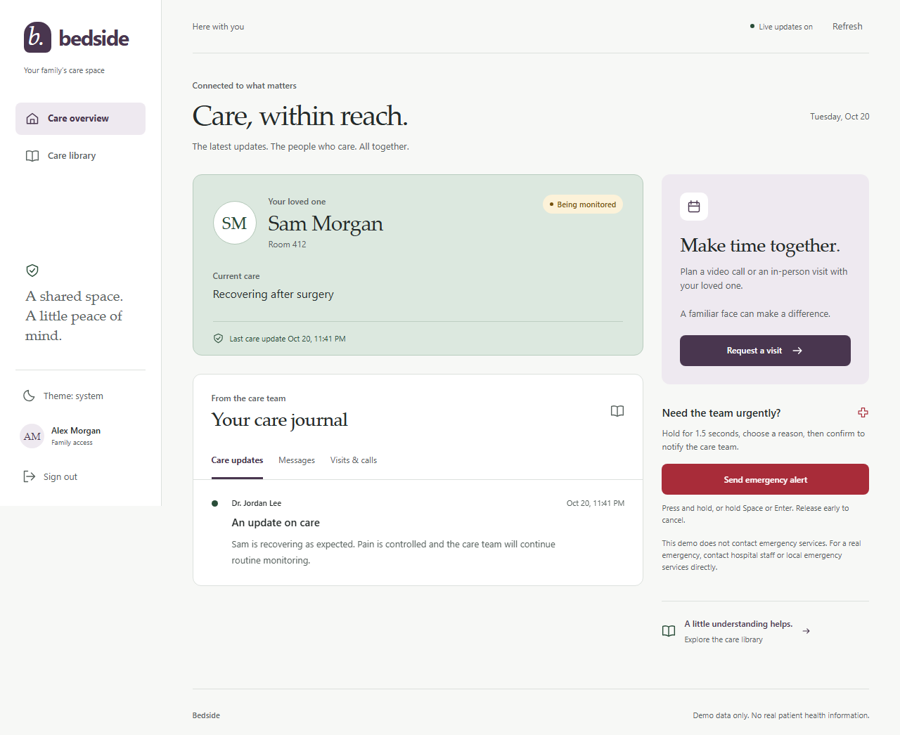

# Bedside

Bedside gives families a calm view of hospital care and clinicians a patient triage workspace. Families can read care updates, message the care team, request visits, and follow an emergency alert from sent to acknowledged to resolved.

**Demo data only. No real patient health information.** All accounts and care records are fictional. Alerts stay inside this demo; they do not contact hospital staff or emergency services. This is a portfolio application, not a clinical system.



## Run locally

Use Node.js 22 LTS (Node 20 is also supported) and npm. From this directory:

```sh
npm ci
npm start
```

Open **http://localhost:3000**. The first start creates the SQLite schema and seeds an empty database. Later starts preserve existing records. No API keys or external services are required. The pinned SQLite dependency includes native binaries for common platforms; an unsupported platform may need a native build toolchain.

Choose either demo button on the login screen, or use:

| Role | Email | Password |
| --- | --- | --- |
| Family | `family@demo.test` | `demo-password` |
| Clinician | `clinician@demo.test` | `demo-password` |

Use separate browser profiles or a private window to try both roles at once: cookies are shared between ordinary tabs. The family can see Sam Morgan; the clinician is assigned to Sam and Taylor Reed.

`PORT` overrides port 3000. `DATABASE_PATH` overrides the default `bedside.db` file (`DB_PATH` is a fallback alias). The app reads process environment variables; it does not load `.env` files. For a disposable demo in PowerShell:

```powershell
$env:DATABASE_PATH = ':memory:'
npm start
```

That database disappears when the server exits. Remove the environment override to return to the saved database. To start a fresh persistent demo, stop the server and choose a new database path.

## Try the complete flow

1. Sign in as family and open the care journal. Send a message or request a video/in-person visit.
2. In a separate browser session, sign in as clinician. Publish a care update and confirm or decline the visit.
3. As family, hold **Send emergency alert** for 1.5 seconds using a pointer, Space, or Enter. Choose a reason and confirm.
4. The clinician receives a blocking dialog with a waiting timer. Acknowledge the alert, then mark it resolved.
5. The family sees each status live. Returning after a disconnection retrieves the persisted status.

Visit requests schedule a visit; this demo does not implement video calling.

## Verification

```sh
npm test
npx playwright install chromium
npm run test:e2e
```

The API/seed suite covers demo authentication, idempotent seeding, patient isolation, role checks, CSRF, login throttling, messages, appointments, emergency transitions, SSE delivery/filtering, session revocation, and CSP. Browser tests use the real server for both roles and cover the complete care flow, missed-alert recovery, keyboard controls, and a 360px dark-mode layout. Screenshots are generated under ignored `test-results/`.

Tests use separate in-memory databases and never use the normal `bedside.db`. API tests bind an available port; browser tests reserve port 3087. GitHub Actions is configured for Node 20 and 22, including Chromium tests.

## Implementation

- Express 4, SQLite (`better-sqlite3`), native JavaScript modules, and vanilla HTML/CSS.
- Password hashing with scrypt; opaque, expiring HttpOnly sessions stored as token hashes in SQLite.
- Role and patient-assignment checks on reads, writes, and live event delivery. Stream sessions are checked before delivery and during heartbeats.
- SameSite cookies, a required custom header for mutations, login throttling, strict CSP, escaped UI content, and parameterized SQL.
- Server-sent events deliver committed changes. REST reads recover current state after reconnecting; there is no durable event replay log.
- Responsive family and clinician views, system/light/dark themes, reduced-motion support, visible keyboard focus, and live announcements.

The demo runs as one Node process with local SQLite storage and an in-process event hub. Public hosting, multi-instance delivery, production identity management, clinical auditing, and real healthcare integrations are outside this build. Shared demo accounts are intentionally public; keep the data fictional.

See the [case study](docs/case-study.md) for design decisions, [build contract](SPEC.md) for the API, and [integration notes](docs/agent-notes/integration.md) for validation. The original class project, “Hospital Remote Connect,” is preserved under `legacy/v1-hospital-remote-connect/` and is not used by the current app.
