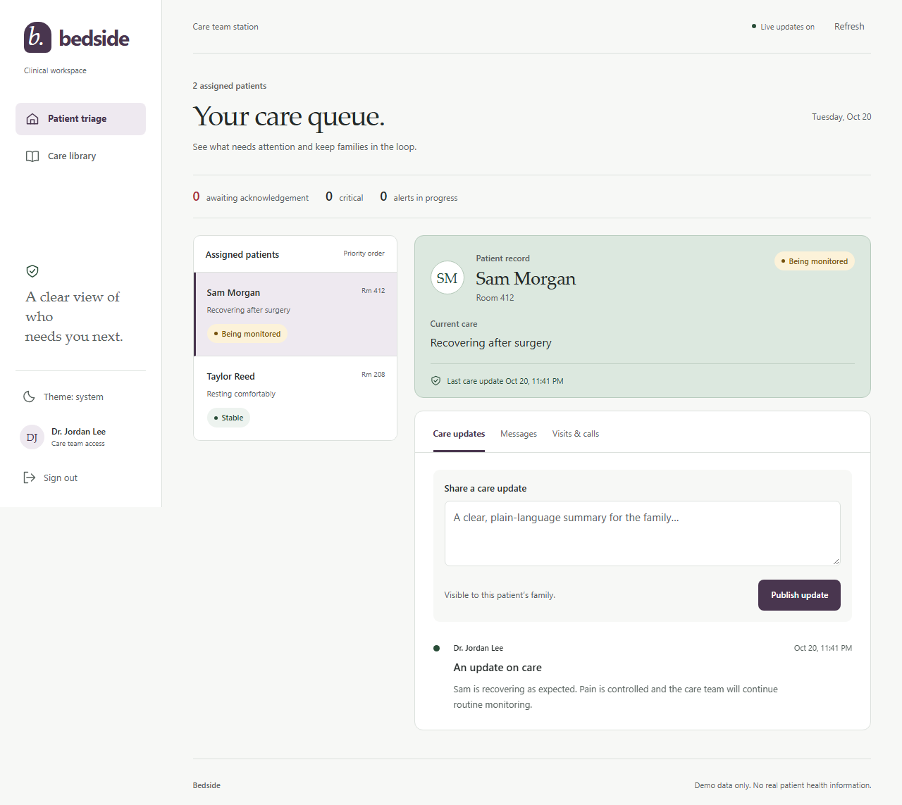
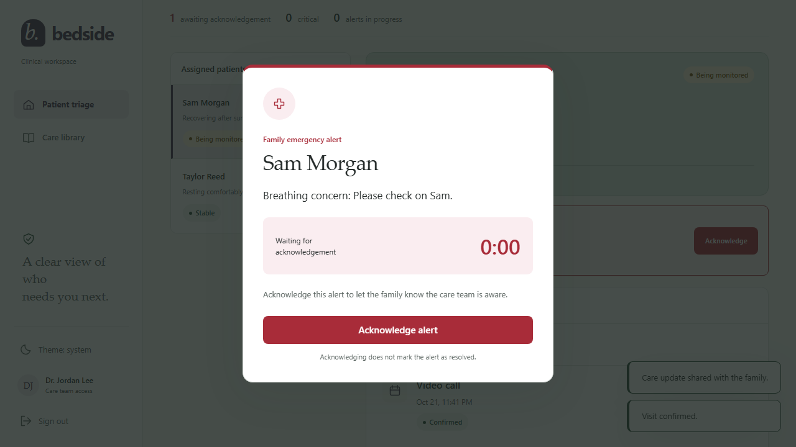
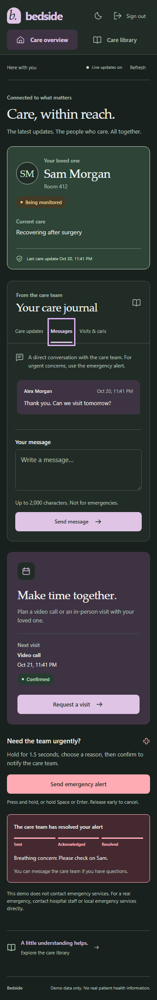

# Bedside: keeping families connected to care

Bedside rebuilds the Hospital Remote Connect class project around two different needs. A family member wants an understandable account of one person's care. A clinician needs to find the patient who needs attention and act quickly. All identities and care information in this project are fictional.

## Two views of the same care record

The family view leads with a patient overview, then a care journal with updates, messages, and visits. A plum and sage palette, generous spacing, and plain-language status labels support a calm reading experience.

The clinician view uses a patient queue, prioritizing waiting alerts, other open alerts, and critical conditions. It shares the same visual language while fitting more information and actions into one workspace.

## An emergency has a visible lifecycle

A continuous 1.5-second hold, a reason, and an explicit confirmation precede an alert. Early release cancels the hold. The clinician gets a blocking dialog with a waiting timer; acknowledging it and resolving it are separate actions.

The server saves the alert before publishing its event. Both roles see the same persisted lifecycle: `sent → acknowledged → resolved`. Illegal transitions are rejected. If the family misses an event, a patient-authorized REST read retrieves the latest status after reconnecting or reloading. This avoids treating a live connection as the source of truth.

## Small, inspectable architecture

Express serves the UI and JSON API. SQLite stores users, hashed sessions, patient links, care records, and alerts. The browser uses one API wrapper and an EventSource connection. This keeps the demo easy to run without a frontend build or external services.

Authorization belongs on every API route and live event recipient, not just on the screen that offers a button. Tests check that a family cannot discover another patient's records, that clinicians have the required assignments, and that a logged-out stream stops receiving updates.

Integration exposed two mismatches between separately developed components: the seed's password format differed from authentication, and the alert writer used a column absent from the schema. The integrated implementation shares the password helper and uses the schema's alert fields, with regression tests exercising both through real endpoints.

## Mobile and verification

At 360px the patient identity and status use separate rows so the name has room. Themes follow the system or a manual preference. Keyboard tabs, hold controls, native dialogs, focus indicators, and reduced-motion styles are part of the implementation.

Automated verification combines API/seed tests with a two-browser family/clinician journey against the real server. The browser suite checks care updates, messaging, visit confirmation, emergency delivery, recovery after leaving the app, resolution, sign-out, keyboard navigation, and horizontal overflow. Desktop and mobile screenshots were also reviewed. These checks are not a full accessibility certification or evidence of clinical suitability.

## Boundaries

This is a local portfolio demo. Appointment requests do not establish video calls. Emergency alerts do not reach real care teams. The event hub is in memory and supports one Node process; durable replay, production authentication, clinical audit trails, and deployment operations would require additional work before any real-world use.
